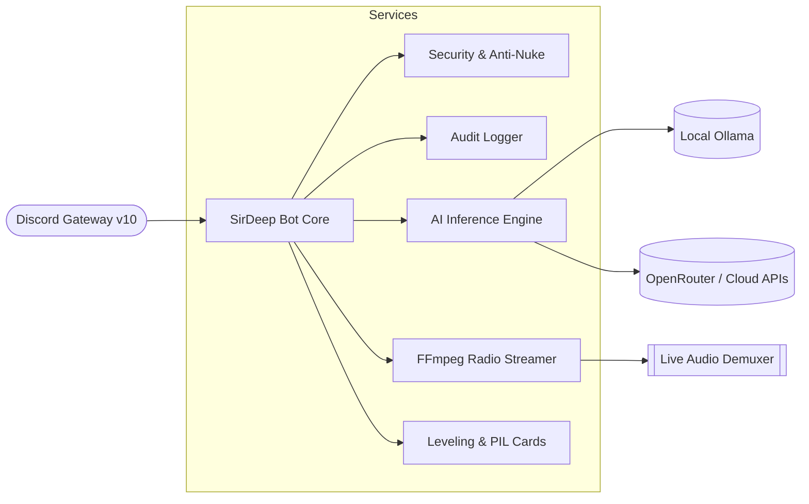

<div align="center">


# SirDeep

**Autonomous community infrastructure for modern engineering guilds.**  
*Self-hosted. Zero telemetry. Built for OpenWinter.*

[Architecture](#architecture) · [Quickstart](#quickstart) · [Documentation](docs/USAGE_GUIDE.md) · [Contributing](CONTRIBUTING.md) · [License](LICENSE)

</div>

---

## Overview

SirDeep is a modular, self-hosted Discord automation core designed for software engineering communities. Built asynchronously with `discord.py` and Python 3.11+, it consolidates audit monitoring, security rate-limiting, local/cloud AI pair programming, 24/7 low-latency audio streaming, and dynamic contributor recognition into a single containerized process.

- **Zero Telemetry**: No third-party data collection. Completely private and self-contained.
- **Local or Cloud AI**: Native support for local Ollama instances alongside OpenRouter, OpenAI, and Gemini.
- **Audit & Anti-Nuke Watchdog**: Real-time moderation logging and automatic privilege revocation on rapid deletions.
- **Dynamic PIL Leveling**: High-definition glassmorphic contributor cards generated on-demand.
- **Continuous Radio**: Low-memory FFmpeg streaming for ambient and lo-fi audio.

---

## Contributor Recognition

SirDeep includes a built-in PIL rendering pipeline that dynamically generates high-DPI contributor profile cards with custom status rings, anti-aliased avatars, and role progression badges:

<div align="center">
  
</div>

---

## Architecture



---

## Quickstart

### Docker Compose (Recommended)

```bash
# Clone the repository
git clone https://github.com/OpenWinter/sirdeep.git
cd sirdeep

# Configure environment
cp .env.example .env
cp config/config.example.yaml config/config.yaml

# Start container in detached mode
docker compose up -d --build
```

### Local Python Environment

```bash
python -m venv .venv
source .venv/bin/activate  # On Windows: .venv\Scripts\activate
pip install -r requirements.txt

cp .env.example .env
cp config/config.example.yaml config/config.yaml

python main.py
```

---

## Configuration

### Environment Variables (`.env`)

| Key | Description | Example |
| :--- | :--- | :--- |
| `DISCORD_BOT_TOKEN` | Bot application token | `Required` |
| `DISCORD_GUILD_ID` | Primary server Snowflake ID | `123456789012345678` |
| `AI_PROVIDER` | Backend provider (`openrouter`, `ollama`, `gemini`, `openai`) | `openrouter` |
| `OPENROUTER_API_KEY` | API Key for OpenRouter models | `sk-or-v1-...` |
| `OLLAMA_BASE_URL` | Local inference endpoint | `http://localhost:11434` |
| `FFMPEG_PATH` | Custom FFmpeg binary path (optional) | `/usr/bin/ffmpeg` |

Detailed module configuration (stations, security thresholds, XP curves) is managed in `config/config.yaml`. See the [Full User Guide](docs/USAGE_GUIDE.md) for details.

---

## Security

SirDeep implements strict protocol validation on audio streams (SSRF prevention), bounded image decompression (`Image.MAX_IMAGE_PIXELS`), and input sanitization on all AI prompts.

To report a vulnerability, please review our [Security Policy](SECURITY.md).

---

## Community & Contributing

SirDeep is an open-source project maintained by the **OpenWinter** community.

- Review our [Contributing Guidelines](CONTRIBUTING.md) for code style, type safety, and PR workflow.
- Review our [Code of Conduct](CODE_OF_CONDUCT.md).

---

## License

[MIT License](LICENSE) © 2026 OpenWinter
