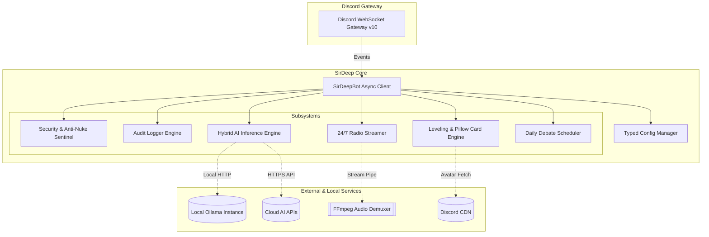

<p align="center">
  
</p>

<h1 align="center">⚡ SirDeep</h1>

<p align="center">
  <b>The Autonomous Community Engine & AI Companion for Developer Guilds</b><br>
  <i>Built for <a href="https://github.com/OpenWinter">OpenWinter</a> — Fast, Resilient, and 100% Open-Source.</i>
</p>

<p align="center">
  <a href="#-key-capabilities">Key Features</a> •
  <a href="#-quickstart-guide">Quickstart</a> •
  <a href="#-system-architecture">Architecture</a> •
  <a href="#-configuration-reference">Configuration</a> •
  <a href="#-security--intents">Security & Intents</a> •
  <a href="#-contributing">Contributing</a>
</p>

---

## 🌟 Overview

**SirDeep** is a production-grade Discord application engineered specifically for developer communities, open-source organizations, and technical teams. Unlike monolithic generic bots, SirDeep is modular, lightweight, and self-hostable with **zero external telemetry**.

It combines a **real-time security watchdog**, **multi-station 24/7 coding radio**, **pluggable cloud/local AI engine**, **glassmorphic contributor card generation**, and **automated technical debate orchestration** into a unified, asynchronous Python core.

---

## 🚀 Key Capabilities

### 🛡️ Autonomous Security & Audit Sentinel
* **Anti-Nuke Rate Limiter**: Automatically detects and halts rapid channel or role deletions caused by compromised admin accounts or rogue integrations.
* **Instant Staff Quarantine**: Immediately strips administrative privileges from flagged actors upon abnormal deletion velocities.
* **Audit Sentinel**: Streams detailed, color-coded moderation events (bans, unbans, kicks, timeouts, role modifications, channel updates) to your private `#audit-logs` channel in real time.
* **Phishing & Malicious Domain Shield**: Regex-based heuristic inspection of message URLs against known scam and credential harvesting patterns.

### 🧠 Pluggable AI Companion
* **Multi-Provider Support**: Seamlessly switch between **OpenRouter**, **Google Gemini**, **OpenAI**, or 100% offline local inference via **Ollama**.
* **Sliding TTL Memory**: Retains conversation history per developer with configurable time-to-live and automatic memory pruning.
* **Built-in Prompt Guard**: Input sanitization, length boundaries, and injection pattern filtering to protect your token quota and prevent context leakage.

### 📻 24/7 Lo-Fi & Deep Work Radio
* **Low-Latency Streaming**: Hardware-accelerated audio demuxing via FFmpeg.
* **Curated Stations**: Pre-configured feeds for *Lo-Fi Beats*, *Synthwave & Cyberpunk*, *Chillhop*, and *Deep Focus Flow*.
* **Fault-Tolerant Reconnect**: Automatically recovers and rejoins the designated voice channel after network drops or Discord gateway reconnections.

### 📊 Dynamic Contributor Leveling & Glassmorphic Cards
* **Custom Profile Renderer**: Generates high-DPI (1000×520) glassmorphic contributor cards directly in Python using Pillow.
* **Anti-Aliased Circular Avatars**: Securely pulls avatars from Discord CDN with strict byte limits and decompression-bomb safeguards.
* **Contributor Tiers**: Automatically awards visual badges (`BUILDER`, `CORE CONTRIBUTOR`, `SENIOR ARCHITECT`) based on community engagement and helpfulness.

<p align="center">
  
</p>

### 💬 Daily Engineering Dilemmas
* **Autonomous Debates**: Posts scheduled, high-signal technical debate prompts into your discussions channel.
* **Dedicated Threads**: Automatically spawns a discussion thread for each dilemma (e.g. *Monolith vs Microservices*, *Rust vs Go for Tooling*, *Postgres vs ClickHouse*).

---

## 🏛️ System Architecture



---

## ⚡ Quickstart Guide

### Option 1: Docker Compose (Recommended)

The easiest way to run SirDeep in production with zero host dependency conflicts:

```bash
# 1. Clone repository
git clone https://github.com/OpenWinter/sirdeep.git
cd sirdeep

# 2. Configure credentials
cp .env.example .env
cp config/config.example.yaml config/config.yaml

# 3. Edit your .env with your bot token
nano .env

# 4. Launch in detached mode
docker compose up -d --build
```

View live logs:
```bash
docker compose logs -f
```

---

### Option 2: Native Python

**Requirements**:
* Python 3.11 or higher
* FFmpeg installed and available on system `PATH` (or set `FFMPEG_PATH` in `.env`)

```bash
# 1. Clone & enter project
git clone https://github.com/OpenWinter/sirdeep.git
cd sirdeep

# 2. Create and activate a virtual environment
python -m venv .venv
source .venv/bin/activate  # On Windows: .venv\Scripts\activate

# 3. Install production dependencies
pip install -r requirements.txt

# 4. Configure environment
cp .env.example .env
cp config/config.example.yaml config/config.yaml

# 5. Start SirDeep
python main.py
```

---

## ⚙️ Configuration Reference

### Environment Variables (`.env`)

| Variable | Description | Default / Example |
| :--- | :--- | :--- |
| `DISCORD_BOT_TOKEN` | Discord Bot token from Developer Portal | `Required` |
| `DISCORD_GUILD_ID` | Primary server Snowflake ID | `123456789012345678` |
| `AI_PROVIDER` | Active AI backend (`openrouter`, `gemini`, `openai`, `ollama`) | `openrouter` |
| `OPENROUTER_API_KEY` | OpenRouter API key | `Optional` |
| `GEMINI_API_KEY` | Google Gemini API key | `Optional` |
| `OLLAMA_BASE_URL` | Local Ollama endpoint | `http://localhost:11434` |
| `FFMPEG_PATH` | Explicit path to FFmpeg binary | *(System PATH / Auto-detect)* |

### Server Configuration (`config/config.yaml`)

```yaml
guild:
  name: "OpenWinter"
  primary_color: 0x00d2ff
  accent_color: 0x10b981

channels:
  audit_logs: "audit-logs"
  welcome: "welcome"
  debates: "tech-debates"
  radio_voice: "24-7-coding-radio"

security:
  anti_nuke:
    max_channel_deletions_per_minute: 3
    max_role_deletions_per_minute: 3
    quarantine_action: "strip_roles"

radio:
  default_station: "lofi"
  auto_reconnect: true
```

---

## 🔒 Security & Gateway Intents

### Required Privileged Gateway Intents
To enable real-time audit event capturing, member welcome generation, and interactive chat, SirDeep requires the following intents in the **Discord Developer Portal**:

1. Navigate to **Applications** $\rightarrow$ **SirDeep** $\rightarrow$ **Bot**.
2. Under **Privileged Gateway Intents**, enable:
   * ✅ **Server Members Intent**
   * ✅ **Message Content Intent**
3. Save changes.

### Security Disclosures
For details on reporting security vulnerabilities, please refer to our [SECURITY.md](SECURITY.md). We adhere to coordinated vulnerability disclosure with a 48-hour initial response SLA.

---

## 🤝 Contributing

We welcome contributions from developers worldwide! Here is how to get involved:

1. **Fork the Repository** to your personal GitHub account.
2. **Create a Feature Branch**:
   ```bash
   git checkout -b feat/my-new-feature
   ```
3. **Commit Your Changes** following [Conventional Commits](https://www.conventionalcommits.org/):
   ```bash
   git commit -m "feat(ai): add Claude 3.5 Sonnet provider preset"
   ```
4. **Push to Your Branch**:
   ```bash
   git push origin feat/my-new-feature
   ```
5. **Open a Pull Request** describing your changes and testing steps.

---

## 📜 License

Distributed under the **MIT License**. See [LICENSE](LICENSE) for more information.

<p align="center">
  <b>Built with ❄️ by <a href="https://github.com/OpenWinter">OpenWinter</a></b><br>
  <i>Empowering open-source developers, one community at a time.</i>
</p>
