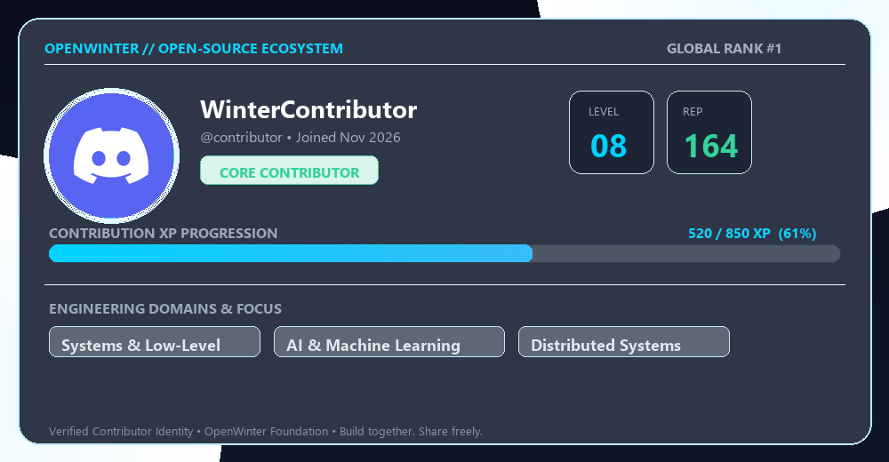
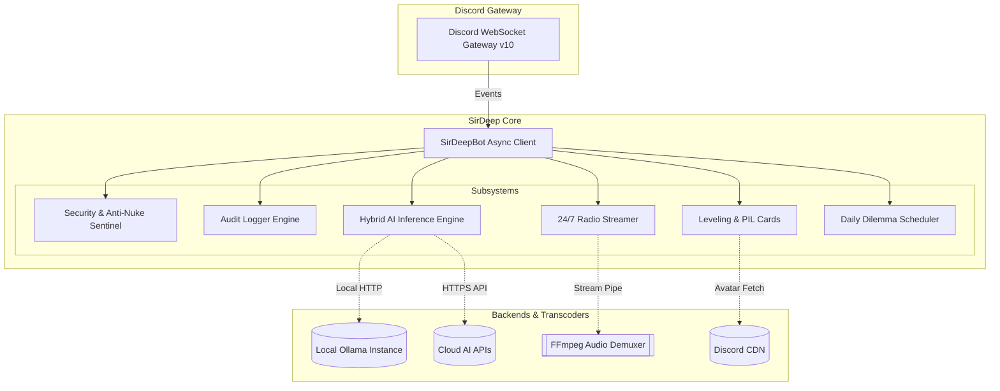

<div align="center">


# ⚡ SirDeep

**The Autonomous Community Engine & AI Companion for Developer Guilds**  
*Self-hosted. Low-latency. Zero telemetry. Built for OpenWinter.*

```
v1.0.0-release • Python 3.11+ • Discord Gateway v10 • MIT Licensed • Docker Ready
```

[Architecture](#-architecture) · [Feature Matrix](#-feature-matrix) · [Contributor Cards](#-contributor-passports) · [Quickstart](#-quickstart) · [Configuration](#-configuration) · [Documentation](docs/USAGE_GUIDE.md) · [Contributing](CONTRIBUTING.md)

</div>

---

## ❄️ Overview

**SirDeep** is an open-source, asynchronous community infrastructure bot engineered specifically for software development guilds, open-source organizations, and technical teams.

Unlike bloated, multi-purpose bots loaded with invasive analytics, SirDeep operates on a **zero-telemetry, zero-trust security model**. It consolidates autonomous moderation logging, anti-nuke staff quarantine, hybrid local/cloud AI pair programming, continuous 24/7 lo-fi radio, and dynamic PIL glassmorphic rank card generation into a unified, lightweight Python core.

---

## ⚡ Feature Matrix

| Subsystem | Capabilities | Technology Stack |
| :--- | :--- | :--- |
| **🛡️ Audit Sentinel** | Captures kicks, bans, timeouts, and channel/role lifecycle updates into `#audit-logs`. | Discord Audit Gateway v10 |
| **🚨 Anti-Nuke Shield** | Intercepts rapid channel/role deletions and strips administrative roles from flagged actors. | Sliding Window Velocity Limiter |
| **🧠 AI Companion** | High-signal pair programming, systems debugging, and sliding-window context memory. | Local Ollama GPU / OpenRouter |
| **📻 24/7 Deep Radio** | Continuous audio stream with automatic gateway reconnects on network drops. | Hardware-Accelerated FFmpeg |
| **🏆 Contributor Cards** | High-DPI (1000×520) glassmorphic cards with anti-aliased avatars and tier progression. | Pillow (PIL) Dynamic Compositor |
| **💬 Tech Dilemmas** | Automated scheduled engineering debates with automatic thread indexing. | Asyncio Event Scheduler |

---

## 🏆 Contributor Passports

SirDeep includes a built-in graphics compositor that generates high-definition contributor profile cards directly in Python without headless browsers or external rendering APIs:

<div align="center">
  
</div>

### Progression Tiers
* **Level 1 – 4**: `BUILDER` (Initial community onboarding)
* **Level 5 – 14**: `CORE CONTRIBUTOR` (Consistent technical contributions)
* **Level 15+**: `SENIOR ARCHITECT` (Architectural leadership & mentorship)

---

## 🏛️ Architecture



---

## 🚀 Quickstart

### Option A: Docker Compose (Recommended)

Deploy SirDeep in an isolated Linux container with pre-bundled FFmpeg and TrueType fonts:

```bash
# 1. Clone repository
git clone https://github.com/OpenWinter/sirdeep.git
cd sirdeep

# 2. Configure credentials
cp .env.example .env
cp config/config.example.yaml config/config.yaml

# 3. Launch in detached mode
docker compose up -d --build

# 4. View live logs
docker compose logs -f
```

---

### Option B: Local Python Environment

**Prerequisites**: Python 3.11+ and `ffmpeg` installed on your system `PATH`.

```bash
# 1. Clone & enter project
git clone https://github.com/OpenWinter/sirdeep.git
cd sirdeep

# 2. Create and activate a virtual environment
python -m venv .venv
source .venv/bin/activate  # On Windows: .venv\Scripts\activate

# 3. Install production dependencies
pip install -r requirements.txt

# 4. Configure environment
cp .env.example .env
cp config/config.example.yaml config/config.yaml

# 5. Start SirDeep
python main.py
```

---

## ⚙️ Configuration

### Environment Variables (`.env`)

| Variable | Description | Example / Default |
| :--- | :--- | :--- |
| `DISCORD_BOT_TOKEN` | Discord Bot Token from Developer Portal | `Required` |
| `DISCORD_GUILD_ID` | Primary server Snowflake ID | `123456789012345678` |
| `AI_PROVIDER` | Active AI backend (`openrouter`, `ollama`, `gemini`, `openai`) | `openrouter` |
| `OPENROUTER_API_KEY` | OpenRouter API Key | `Optional` |
| `OLLAMA_BASE_URL` | Local Ollama endpoint | `http://localhost:11434` |
| `FFMPEG_PATH` | Custom FFmpeg binary path override | *(Auto-detects from PATH)* |
| `ENVIRONMENT` | Running mode (`production` or `development`) | `production` |

---

## 🔒 Gateway Intents Setup

> [!IMPORTANT]
> To enable real-time audit event capturing, member welcome generation, and interactive chat, you **must enable Privileged Gateway Intents** in the [Discord Developer Portal](https://discord.com/developers/applications):
>
> 1. Go to **Applications** $\rightarrow$ **SirDeep** $\rightarrow$ **Bot**.
> 2. Under **Privileged Gateway Intents**, toggle **ON**:
>    * ✅ **Server Members Intent**
>    * ✅ **Message Content Intent**
> 3. Click **Save Changes**.

---

## 📂 Project Structure

```text
sirdeep/
├── assets/
│   ├── branding/              # High-DPI banner and contributor card assets
│   └── fonts/                 # Bundled TrueType typography
├── config/
│   ├── config.example.yaml    # Server channels, thresholds, and station configs
│   └── debates.json           # Curated technical dilemma pool
├── docs/
│   └── USAGE_GUIDE.md         # Comprehensive operator manual
├── src/
│   ├── core/
│   │   ├── audit.py           # Real-time Discord audit log gateway listener
│   │   ├── config.py          # Typed dataclass configuration parser
│   │   └── security.py        # Anti-nuke velocity limiter and quarantine logic
│   └── modules/
│       ├── ai/                # Hybrid Ollama/OpenRouter chat engine
│       ├── debates/           # Daily scheduled architectural debates
│       ├── leveling/          # PIL high-DPI card renderer & XP engine
│       └── radio/             # Low-latency FFmpeg audio demuxer
├── .env.example               # Clean environment variables template
├── .gitignore                 # Strict secret & runtime artifact filter
├── docker-compose.yml         # 1-command container orchestration
├── Dockerfile                 # Debian-slim production container
├── LICENSE                    # MIT License
├── main.py                    # Asynchronous Discord bot entrypoint
├── requirements.txt           # Hardened production dependencies
└── SECURITY.md                # Coordinated vulnerability disclosure policy
```

---

## 🤝 Community & Contributing

SirDeep is developed and maintained by the **[OpenWinter](https://github.com/OpenWinter)** engineering community.

* 📘 Review our **[Contributing Guidelines](CONTRIBUTING.md)** for coding standards, type hints, and PR workflow.
* 📜 Review our **[Code of Conduct](CODE_OF_CONDUCT.md)** for community values.
* 🔒 Review our **[Security Policy](SECURITY.md)** for private vulnerability reporting.

---

## 📜 License

Distributed under the **[MIT License](LICENSE)**. © 2026 OpenWinter.

<div align="center">
  <b>Built with ❄️ by <a href="https://github.com/OpenWinter">OpenWinter</a></b><br>
  <i>Empowering open-source engineering communities.</i>
</div>
